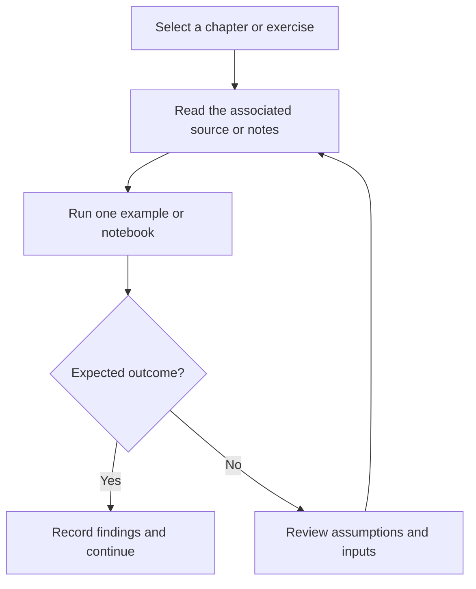

# C Console Projects

Console games and small management exercises in C, including number guessing, tic-tac-toe, and rock-paper-scissors.

## Project focus

C/C++ exercises. Use the directory map to choose a focused example or learning topic instead of treating the repository as one application.

## Workflow



## Repository structure

| Path | Purpose |
| --- | --- |
| [`Guess_number.c`](Guess_number.c) | Standalone programming exercise or example. |
| [`Main_Menu_Project.c`](Main_Menu_Project.c) | Standalone programming exercise or example. |
| [`Rock_Paper_Scissor.c`](Rock_Paper_Scissor.c) | Standalone programming exercise or example. |
| [`Tic_Tac_Toe.c`](Tic_Tac_Toe.c) | Standalone programming exercise or example. |
| [`cyber_management.c`](cyber_management.c) | Standalone programming exercise or example. |

## Getting started

```bash
git clone https://github.com/Raimal-Raja/C-Projects.git
cd C-Projects
```

Use a compatible C/C++ compiler. Build each source file separately because many exercises define their own entry point.

```bash
gcc -std=c11 -Wall -Wextra Guess_number.c -o exercise
./exercise
```

## Verification

Compile or run one exercise at a time, test ordinary and boundary inputs, and compare the output with its stated problem. A successful build is not proof of algorithmic correctness.

## Contributing

Include reproduction steps, the affected path, expected behavior, and the checks you ran. Keep credentials, generated environments, and unnecessary build artifacts out of commits.

## License

No top-level license file is currently tracked. Check reuse permissions with the repository owner.
